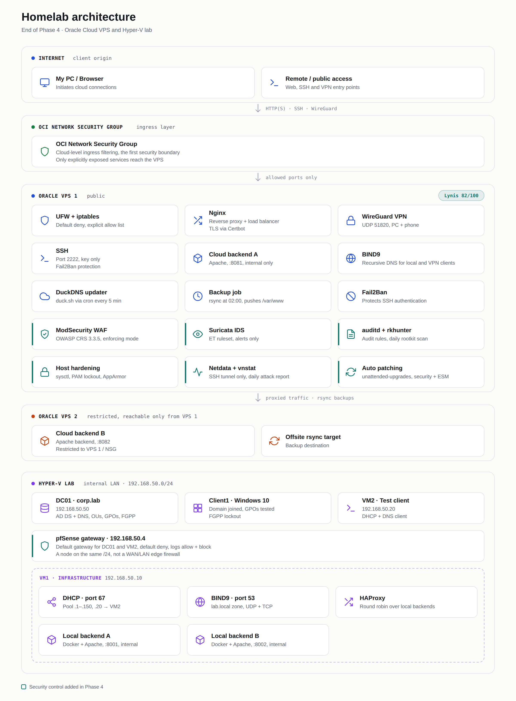

# IT Homelab

**M. Sohaib** | Aspiring Cloud Engineer, with a foundation in Linux, networking and systems administration

I am building toward a Cloud Engineer role, and this repository is the hands-on preparation for it. The same skills also apply directly to IT Support, Systems Administrator and Network Administrator roles, and I am open to opportunities across all of them.

Over about five months (since May 2026) I built, broke, fixed and documented a real infrastructure lab: public-facing servers on Oracle Cloud, a local Hyper-V environment with Windows Active Directory, and the security work to protect them. Every lab README records what I configured and how I verified it worked.

## At a Glance

| | |
|---|---|
| **Live site** | [sohaib-lab.duckdns.org](https://sohaib-lab.duckdns.org) (nginx reverse proxy, Let's Encrypt TLS, ModSecurity WAF) |
| **Interactive architecture** | [architecture diagram](https://sohaib-lab.duckdns.org/architecture-diagram.html) |
| **Lynis hardening score** | 66 at baseline, 69 after Phase 3, 68 at the start of Phase 4 (unhardened postfix pulled in by rkhunter), **82/100** at the end (target was 80+) |
| **External scan from Kali** | Only 3 TCP ports reachable: SSH (non-standard port), HTTP and HTTPS |
| **Attack data analysed** | 474,952 failed SSH attempts from 4,123 unique IPs over about six months |
| **Incident work** | 4 post-mortems, a simulated C2 incident with full response, and a formal risk assessment |
| **Certifications** | Google IT Support Professional Certificate, Cisco Networking Basics |

## Phases

| Phase | Area | What it covers |
|---|---|---|
| 1 | [Power User](PowerUser/README.md) | Linux and Windows command line: users and permissions, systemd, storage, SSH hardening, PowerShell, event logs |
| 2 | [Networking](Networking/README.md) | ARP, subnetting, DHCP, DNS, routing, packet capture, WireGuard VPN, Squid proxy |
| 3 | [Sysadmin Infrastructure](Sysadmin_Infrastructure/README.md) | Web servers, reverse proxy and load balancing, TLS, firewalls, DNS and DHCP, Active Directory, backups |
| 4 | [Security](Security/README.md) | Cryptography, IDS and WAF, system hardening, incident response, security audits |

All four phases are complete. Each phase README links to the individual labs and shows the commands and results behind every claim.

## Skills Demonstrated

| Skill area | What I did | Where |
|---|---|---|
| Linux administration | Users and permissions, systemd services, storage and swap, partitioning, patching, SSH hardening | [Phase 1](PowerUser/README.md), [Phase 3](Sysadmin_Infrastructure/README.md) |
| Networking | Subnetting, DHCP relay, DNS, routing, tcpdump, mtr, WireGuard VPN, forward proxy | [Phase 2](Networking/README.md) |
| Cloud (Oracle Cloud) | Two VPSes, layered cloud and host firewalls, Docker backends, restricted back-end access | [Phase 3](Sysadmin_Infrastructure/README.md) |
| Web infrastructure | nginx reverse proxy, HAProxy health checks and failover, Apache, Let's Encrypt | [Phase 3](Sysadmin_Infrastructure/README.md) |
| DNS and DHCP | BIND9 (recursive, authoritative, reverse), dnsmasq, ISC DHCP | [Phase 3](Sysadmin_Infrastructure/README.md) |
| Windows and Active Directory | Domain controller, OUs, Group Policy, Fine-Grained Password Policy, PowerShell | [Phase 1](PowerUser/README.md), [Phase 3](Sysadmin_Infrastructure/README.md) |
| Virtualization | Hyper-V internal network with Windows and Linux VMs | [Phase 3](Sysadmin_Infrastructure/README.md) |
| Security monitoring | Suricata IDS with custom rules, ModSecurity WAF, auditd, fail2ban | [Phase 4](Security/README.md) |
| Hardening and auditing | Kernel, PAM and SSH hardening, Lynis, rkhunter, port audit, attacker-view scans | [Phase 4](Security/README.md) |
| Incident response | Simulated C2 incident, post-mortems, risk assessment | [Phase 4](Security/README.md), [Post-Mortems](Post_Mortems/README.md) |
| Automation | Bash scripts, cron, rsync backups with restore test, daily attack summary report | [Phase 3](Sysadmin_Infrastructure/README.md), [Phase 4](Security/README.md) |
| Documentation | Every lab verified with evidence, failures written up as post-mortems | whole repo |

## How This Maps to Cloud Work

This is a concept mapping from what I built to the cloud services it corresponds to. I have not worked in AWS yet, and the AWS series below is where I will do that.

| What I built here | Cloud equivalent |
|---|---|
| OCI network security groups layered with UFW and iptables | Security groups and network ACLs combined with host firewalls |
| Least privilege on users, sudo, ACLs and PAM policy | IAM roles and least-privilege policies |
| auditd, Suricata, ModSecurity logs and the daily attack summary | Cloud audit logging, monitoring and threat detection |
| unattended-upgrades, patch priorities and Lynis audits | Patch management and configuration compliance checks |
| nginx and HAProxy reverse proxying with health checks and failover | Application and network load balancers |
| WireGuard VPN and a back-end reachable only from VPS 1 | VPNs and private subnets |
| rsync backup to a second server with a restore test | Snapshots, object storage backups and restore testing |
| Post-mortems and the VPS risk assessment | Incident response and risk review |

## Architecture



The lab has two environments:

- **Oracle Cloud:** a public-facing VPS (nginx, TLS, WireGuard, BIND9, hardened SSH, host and cloud firewalls) and a second VPS that only accepts traffic from the first
- **Hyper-V:** a local internal network with a Windows Server domain controller, a domain-joined Windows client, Linux VMs running DNS, DHCP and HAProxy, and a pfSense gateway

The Hyper-V network is segmented but not air-gapped from the host, and the documentation says so.

## How I Work

> Learn the concept, observe it, break it, fix it, verify it, document it.

A configuration is not treated as proof that it works. I confirm with direct evidence (`ss`, `dig`, `curl`, `tcpdump`, `journalctl`, `wg show`, service logs, recovery tests, external scans), and when something fails across several layers I write it up as a post-mortem.

## Audits, Reports and Post-Mortems

- [Audits and Reports](Audits_and_Reports/README.md): Lynis scores, the incident report, the VPS risk assessment and the final security posture report
- [Post-Mortems](Post_Mortems/README.md): four write-ups with timeline, root cause, impact, resolution and prevention

## What's Next

- **AWS Cloud Practitioner**, then an AWS Associate-level certification
- **A second homelab series on AWS**, using the same method: build it, verify it, document it

## Repository Structure

```text
homelab/
├── PowerUser/                 Phase 1
├── Networking/                Phase 2
├── Sysadmin_Infrastructure/   Phase 3
├── Security/                  Phase 4
├── Audits_and_Reports/
├── Post_Mortems/
├── assets/
├── LICENSE
└── README.md
```

## Security and Privacy

This repository documents infrastructure and configuration without committing credentials, private keys, tokens or passwords. Some documents include lab-only addressing, ports and internal naming where they help explain the topology.

# Contact 
[LinkedIn](https://www.linkedin.com/in/muhammad-sohaib-943b34349/) | [m.sohaib.it@gmail.com](mailto:m.sohaib.it@gmail.com)

