# Hardening Sprint

For this lab, I wanted to work through the remaining Lynis findings systematically. PAM password policy, auditd file access logging, rkhunter rootkit scan, and a final user account review. By the end of today, the Lynis score should be 10 to 15 points higher than the baseline audit.

# Lab

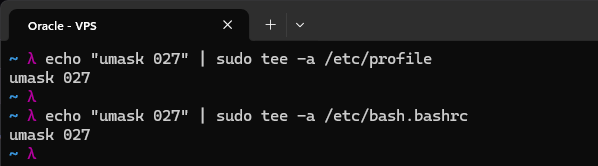

Set umask 027 system-wide, so new files are created with owner rw, group r, and no access for others (new directories get 750). I appended it to both `/etc/profile` and `/etc/bash.bashrc`, so it applies to login shells as well as interactive non-login bash shells:

```
echo "umask 027" | sudo tee -a /etc/profile
echo "umask 027" | sudo tee -a /etc/bash.bashrc
```

Audited all user accounts, ensured no unexpected accounts exist. I looked for UIDs below 1000 that aren't system accounts, and /bin/bash shells on service accounts.

---

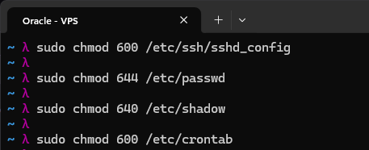

Set secure permissions on sensitive files:

```
sudo chmod 600 /etc/ssh/sshd_config
sudo chmod 644 /etc/passwd
sudo chmod 640 /etc/shadow
sudo chmod 600 /etc/crontab
```

`sshd_config` and `crontab` are root-only (600). `/etc/passwd` has to stay world-readable (644) since a lot of programs use it to map user IDs to names, while the actual password hashes live in `/etc/shadow`, which is 640, readable only by root and the shadow group.

---

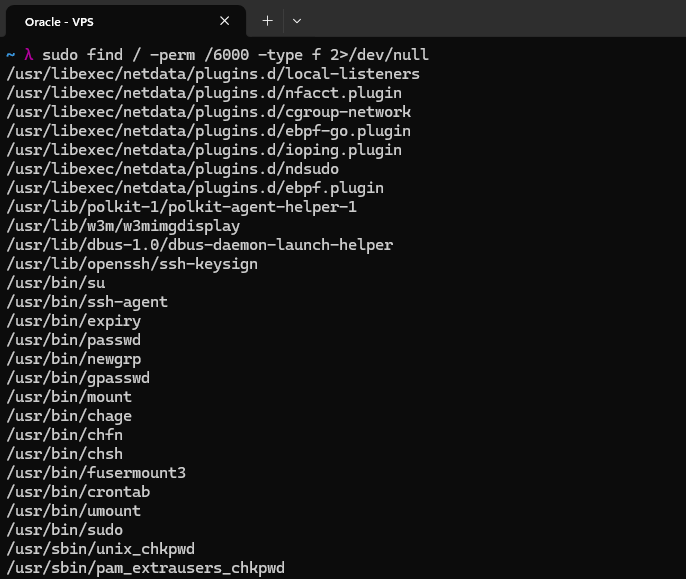

Reviewed SUID/SGID binaries with `sudo find / -perm /6000 -type f 2>/dev/null`, which lists every file that has the setuid or setgid bit set. Compared against a known-good list, no unexpected SUID binaries. The usual su, sudo, passwd, mount and similar tools show up, along with the netdata plugins, which are expected since I installed netdata earlier and its plugins need those privileges to read network and system stats.

---

### PAM - Pluggable Authentication Modules

PAM controls authentication policy for every service on Linux: login, SSH, sudo, su.
I installed pwquality (usually already installed, but was not in this case).

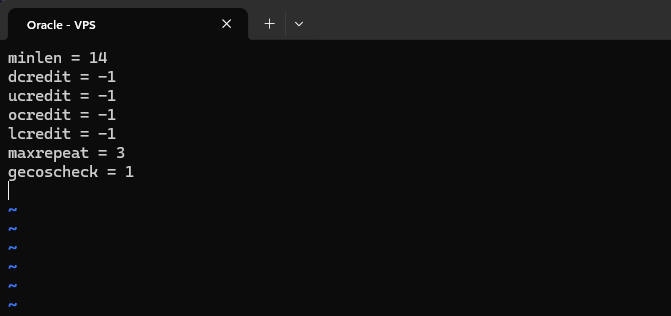

I configured password requirements in `/etc/security/pwquality.conf`:

```
minlen = 14          # minimum 14 characters
dcredit = -1         # at least 1 digit
ucredit = -1         # at least 1 uppercase
ocredit = -1         # at least 1 special char
lcredit = -1         # at least 1 lowercase
maxrepeat = 3        # no more than 3 repeated chars
gecoscheck = 1       # reject passwords containing words from the user's GECOS (full name) field
```

---

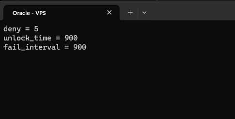

Then I configured account lockout in `/etc/security/faillock.conf`:

```
deny = 5             # lock after 5 failures
unlock_time = 900    # auto-unlock after 15 minutes
fail_interval = 900  # count failures within 15 minutes
```

These values only take effect once `pam_faillock` is part of the PAM stack, so I also made sure the module is referenced in `/etc/pam.d/common-auth` and `/etc/pam.d/common-account`. Without that, the settings in `faillock.conf` would just sit there unused.

---

### auditd - Kernel-Level Audit Logging

`auditd` logs system calls at the kernel level. It can record every file read/write, every privilege escalation, every user switch, with timestamps and the exact command that triggered it. This is what forensic investigators look at after a breach.

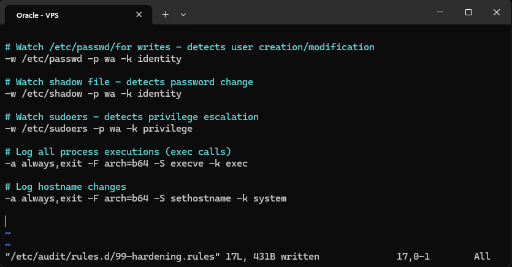

I wrote the rules to `/etc/audit/rules.d/99-hardening.rules`:

```
-w /etc/passwd -p wa -k identity
-w /etc/shadow -p wa -k identity
-w /etc/sudoers -p wa -k privilege
-a always,exit -F arch=b64 -S execve -k exec
-a always,exit -F arch=b64 -S sethostname -k system
```

**Watch /etc/passwd for writes, detects user creation/modification**
Flags: `-w` watch file, `-p wa` trigger on write or attribute change, `-k identity` key tag for searching logs. Every time /etc/passwd is modified (user added, modified, deleted), auditd creates a log entry with the timestamp, who did it, and which process. Use `ausearch -k identity` to query.

**Watch the shadow file, detects password changes**
Any modification to /etc/shadow (which stores password hashes) is logged. A password change from a non-standard process at 3 AM is a strong indicator of compromise. It shares the `identity` key with passwd.

**Watch sudoers, detects privilege escalation config changes**
An attacker who gains limited access often tries to add themselves to sudoers. Auditing sudoers changes means this attempt is logged even if the attacker then removes the change.

**Log all process executions (exec calls)**
Logs every time a new process is spawned (execve system call). This creates a complete timeline of what was run and by whom. Very high log volume on busy systems, so it is typically filtered to specific directories or users. Essential for forensic reconstruction: "what did the attacker run after getting in?"

**Log hostname changes**
Attackers sometimes change hostnames to avoid detection in logs. Logging this syscall creates evidence.

A few reasonable extensions I didn't add this time: also watching `/etc/gshadow`, `/etc/group` and `/etc/sudoers.d/`, logging reads and attribute changes on `auth.log` so that tampering with it gets recorded, and logging clock changes with `-S settimeofday -S adjtimex`, since attackers sometimes alter system time to confuse log correlation.

I loaded the rules without rebooting using `sudo augenrules --load`.

---

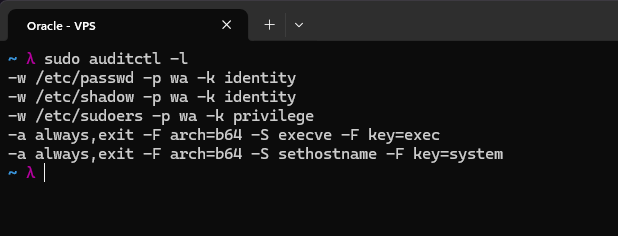

Listed the active rules with `sudo auditctl -l` and confirmed all five rules were applied.

---

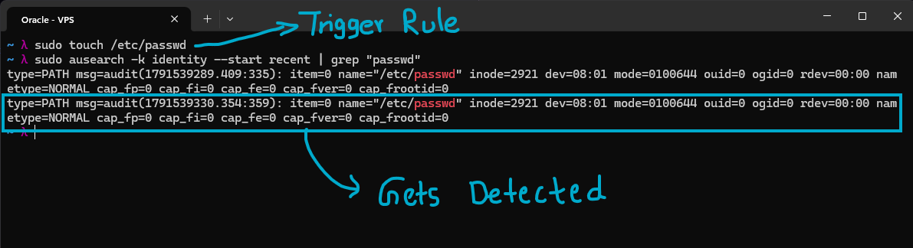

Tested the rules by touching `/etc/passwd` and checking the audit log:

```
sudo touch /etc/passwd   # triggers the watch rule
sudo ausearch -k identity --start recent | grep "passwd"
```

It logs the file access and flags it immediately. The touch doesn't change the contents of the file, but updating its timestamp counts as an attribute change, which is what the `a` in `-p wa` catches. The grep only keeps the PATH record of each event (the file, inode and owner), the SYSCALL record from the same event, which holds the user and the command that did it, gets filtered out, so dropping the grep shows the full picture.

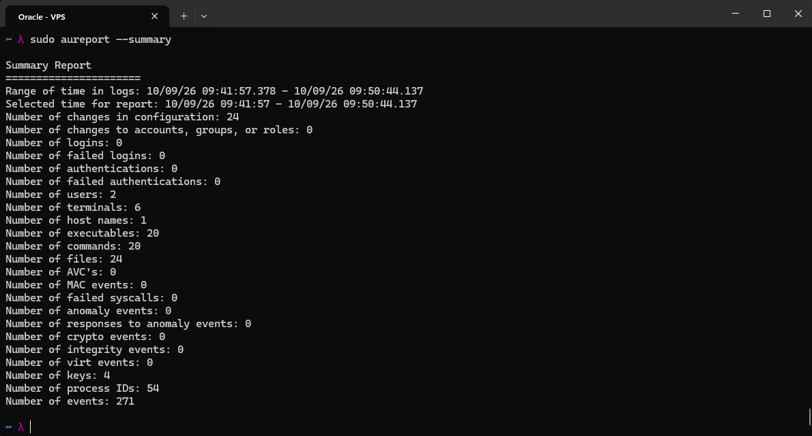

Human-readable audit report with `sudo aureport --summary`. Among other things, it shows 4 keys in the logs, which matches my four key tags (identity, privilege, exec, system).

---

### rkhunter - Rootkit Hunter

rkhunter scans for known rootkits, suspicious files, and signs of system compromise: backdoored binaries, hidden files, suspicious kernel modules.

I installed rkhunter using `sudo apt install rkhunter -y`

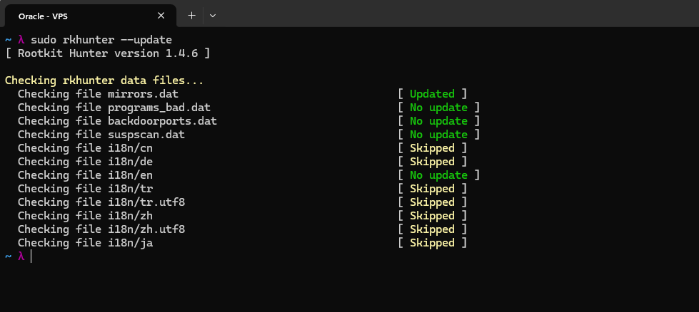

Updated rkhunter's own data files with `sudo rkhunter --update`. This refreshes things like its mirror list and its lists of known bad programs and backdoor ports, in the screenshot the mirrors file was updated and the rest were already current.

---

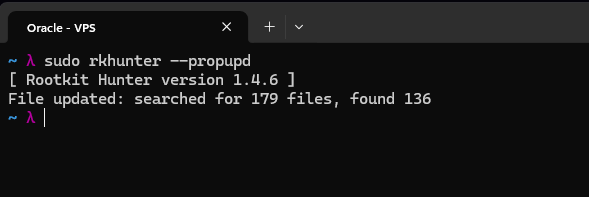

Built a baseline of my system's file properties and hashes (do this BEFORE you think you're compromised):
`sudo rkhunter --propupd`
It searched for 179 files and found 136 of them on this system, those are the ones the baseline now covers.

---

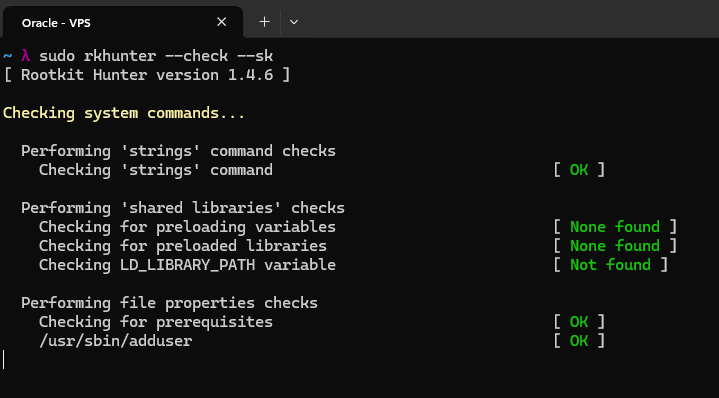

Run the full check:

```
sudo rkhunter --check --sk    # --sk: skip keypress confirmation
```

The screenshot catches the start of the run, the system command checks, the shared library checks (no preloading variables, preloaded libraries or LD_LIBRARY_PATH found) and the file property checks all coming back clean. The rest of the run isn't in the screenshot, but the final summary came back clean as well.

---

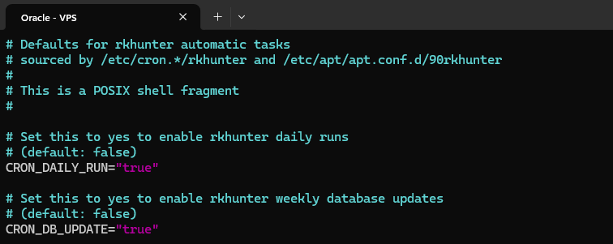

Scheduled rkhunter to run automatically through cron by editing `/etc/default/rkhunter`:

```
CRON_DAILY_RUN="true"
CRON_DB_UPDATE="true"
```

`CRON_DAILY_RUN` enables the daily check and `CRON_DB_UPDATE` enables the weekly database update.

---

## Additional Hardening

In addition to all of the above, below are some extra hardening steps I took towards increasing the resilience of my system:

#### Patching and package hygiene
- Automatic security updates enabled
- Package integrity verification and update-change review tooling installed
- Post-upgrade checks to find services running outdated libraries
- Unused packages, leftover configs and old kernels removed regularly

#### Access and authentication
- Key-based SSH access with root login disabled
- Intrusion prevention (automated banning of repeated failed logins)
- Password hashing and aging policies configured
- System accounts reviewed; unused accounts removed

#### Kernel and OS
- Core dumps disabled
- Unused network protocols and kernel modules blocked
- Mandatory access control (AppArmor) enabled
- Process and system activity accounting enabled

#### Network and services
- Host firewall with a default-restrictive policy, plus a cloud-level firewall as an outer layer
- Only required services are exposed; unused services removed
- Service banners and version information suppressed
- Modern TLS only; legacy protocols disabled
- Web server runs inside a systemd sandbox with restricted privileges
- Web application firewall in front of hosted applications

#### Monitoring and integrity
- File integrity monitoring on critical system files
- Audit logging enabled
- Regular rootkit scans
- Periodic automated security audits to track progress over time

#### Process
- Configuration backups and a rollback plan before each change
- Changes tested in a second session before closing the first
- Re-audit after each round of changes

---

## Hardening Index

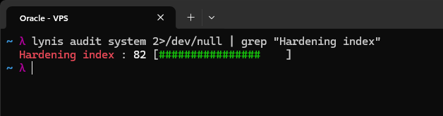

After the hardening sprint, I assessed the VPS again through Lynis (`lynis audit system 2>/dev/null | grep "Hardening index"` to pull out just the score) and this time the score was above 80, specifically 82, up from the baseline of 68 (one point below the end-of-Phase-3 score because of the unhardened postfix that rkhunter had installed as a dependency, which this sprint fixed). That is a 14 point improvement, which was significant compared to earlier assessments.
