# Incident Response

This lab simulates a compromised process on my VPS beaconing out to a command and control (C2) server, with Suricata catching it. The goal was to have a self-contained incident I could build, trigger, and then actually investigate, instead of only reading about incident response theory.

Nothing here is real malware and there is no real C2 server. The attacker's server and the "malware" are both small Python scripts, the C2 address is a reserved non-routable IP, and the detection is a custom Suricata rule. This README covers how the incident was set up and triggered on the VPS, and how I responded to it. The post-mortem and the risk assessment are linked at the bottom.

Suricata was already running on the VPS from the earlier labs, with the loopback interface (lo) added to the interfaces it monitors, since everything in this scenario happens on the VPS itself.

## Detection rule

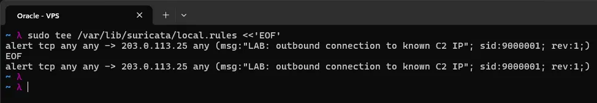

I started with the detection side, a custom Suricata rule that alerts on any TCP traffic going to the C2 address:

```
sudo tee /var/lib/suricata/rules/local.rules <<'EOF'
alert tcp any any -> 203.0.113.25 any (msg:"LAB: outbound connection to known C2 IP"; sid:9000001; rev:1;)
EOF
```

`tee` prints back what it wrote, which is why the rule shows up twice in the screenshot. The rule matches TCP traffic from any source to 203.0.113.25 on any port, so it behaves like a known bad IP that has shown up in a threat intelligence feed. The `LAB:` prefix in the message marks it as a lab rule, and the sid is in the 9xxxxxxx range I use for custom rules so it can't collide with Emerging Threats signatures. `suricata.yaml` had already been updated to load rules from this file, so it is the only custom rule file Suricata loads during this lab. I then reloaded the rules with `sudo suricatasc -c ruleset-reload-rules` so the running Suricata picked up the new rule.

## The fake C2 address

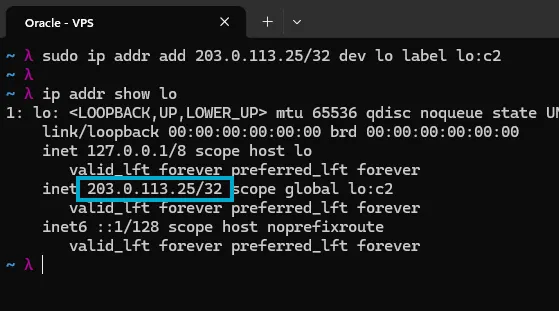

203.0.113.25 is inside 203.0.113.0/24, which is TEST-NET-3, a range IANA reserved for documentation. It is non-routable, so nothing sent to it can ever reach a real machine, which makes it safe to use as a fake attacker address. A socket can only bind to an address the machine actually owns, so I added the fake C2 address to the loopback interface as an alias:

```
sudo ip addr add 203.0.113.25/32 dev lo label lo:c2
ip addr show lo
```

`ip addr show lo` confirms it, the address is listed under lo with the label `lo:c2`, highlighted in the screenshot.

## The fake C2 server

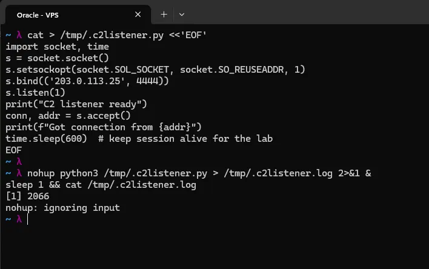

This script plays the role of the attacker's server. It binds to the fake C2 address on port 4444, waits for a single connection, then holds the session open for ten minutes so there is time to investigate. `SO_REUSEADDR` lets me restart it straight away without a bind error from the previous run.

```
cat > /tmp/.c2listener.py <<'EOF'
import socket, time
s = socket.socket()
s.setsockopt(socket.SOL_SOCKET, socket.SO_REUSEADDR, 1)
s.bind(('203.0.113.25', 4444))
s.listen(1)
print("C2 listener ready")
conn, addr = s.accept()
print(f"Got connection from {addr}")
time.sleep(600)  # keep session alive for the lab
EOF
```

I gave it a dot-prefixed name and put it in `/tmp`, so it is hidden from a normal `ls`, and launched it in the background with `nohup`:

```
nohup python3 /tmp/.c2listener.py > /tmp/.c2listener.log 2>&1 &
sleep 1 && cat /tmp/.c2listener.log
```

The log only shows nohup's own message and not the "C2 listener ready" line, because Python buffers its output when it is redirected to a file, so the print hadn't been flushed yet. The listener was running anyway.

## The fake malware

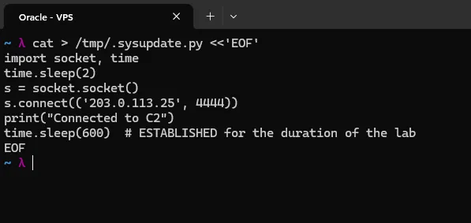

This is the "malware" on the compromised host. It connects out to the C2 address and then just holds the socket open for ten minutes, so the connection stays ESTABLISHED for the whole investigation. It waits two seconds before connecting to make sure the listener is up first.

```
cat > /tmp/.sysupdate.py <<'EOF'
import socket, time
time.sleep(2)
s = socket.socket()
s.connect(('203.0.113.25', 4444))
print("Connected to C2")
time.sleep(600)  # ESTABLISHED for the duration of the lab
EOF
```

The name `.sysupdate.py` is deliberate, it is hidden in `/tmp` and named like a legitimate system update tool, which is the kind of disguise real malware uses to blend in with normal processes.

## Triggering the incident

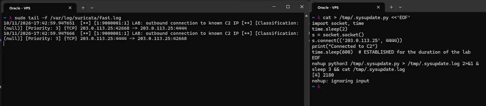

With `fast.log` being watched in one terminal (left), I launched the malware in another (right):

```
nohup python3 /tmp/.sysupdate.py > /tmp/.sysupdate.log 2>&1 &
sleep 3 && cat /tmp/.sysupdate.log
```

As soon as it connected, Suricata fired the C2 rule. One connection produced two alert lines in `fast.log`, one for each direction of the traffic. Since both ends of the connection live on the same machine, both are using 203.0.113.25, so the reply from the listener back to the malware also has the C2 address as its destination and matches the rule too. The alerts show `Classification: (null)` and `Priority: 3`, because the rule has no `classtype` and Suricata falls back to the default priority.

At this point the incident was live: a disguised process holding an open connection to a known C2 address, and an alert sitting in `fast.log` for me to respond to.

## Incident Response

With the alert in `fast.log`, I worked through the incident the way a responder would, in order: identify, find the process, contain, eradicate, recover.

### Identification

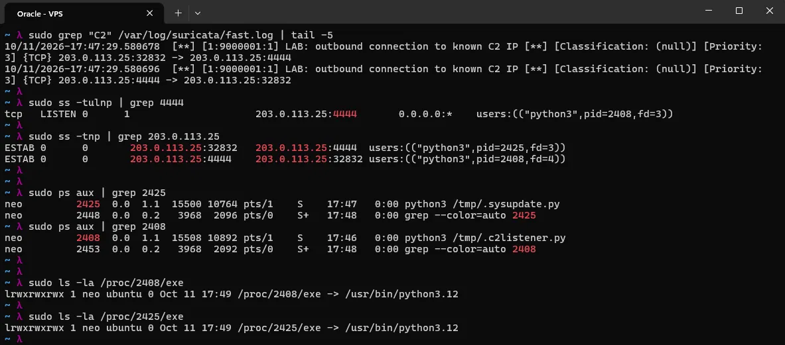

First I confirmed the alert and what it said:

```
sudo grep "C2" /var/log/suricata/fast.log | tail -5
```

This returns the two alert lines for traffic to the C2 address on port 4444, at the top of the screenshot. I also did the usual first check on a possibly compromised box, looking for a CPU spike:

```
top -bn1 | head -15
ps aux --sort=-%cpu | head -10
```

There was nothing to see here since the scripts just sleep, but on a real box a crypto miner or a busy payload would show up in these.

Next I needed the process behind the connection. `ss` shows sockets along with the process that owns them:

```
sudo ss -tulnp | grep 4444
sudo ss -tnp | grep 203.0.113.25
```

The first shows a python3 process (PID 2408) listening on 203.0.113.25:4444. The second shows the ESTABLISHED connection with both ends listed, one python3 process (PID 2425) connecting out from port 32832 to port 4444, and the listener (2408) on the other end. Both ends are visible only because the fake C2 lives on the same machine, in a real incident just the outbound side would be on the host.

```
sudo ps aux | grep 2425
sudo ps aux | grep 2408
sudo ls -la /proc/2425/exe
sudo ls -la /proc/2408/exe
```

`ps` shows `python3 /tmp/.sysupdate.py` and `python3 /tmp/.c2listener.py`, hidden scripts running out of `/tmp`. `/proc/<pid>/exe` shows what binary is actually running, and for both it is `/usr/bin/python3.12`, the normal Python interpreter. So the process name alone tells me nothing, it is the script path in the command line that gives them away.

### Digging into the processes

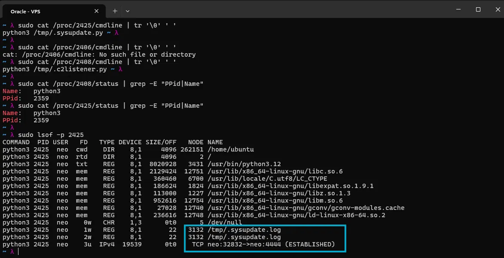

Then I pulled more detail from `/proc` and `lsof`:

```
sudo cat /proc/2425/cmdline | tr '\0' ' '
sudo cat /proc/2408/cmdline | tr '\0' ' '
sudo cat /proc/2425/status | grep -E "PPid|Name"
sudo cat /proc/2408/status | grep -E "PPid|Name"
sudo lsof -p 2425
```

`cmdline` stores the arguments separated by null bytes, which is why it is piped through `tr` to turn them into spaces and get the full command line. One command in the screenshot errors with no such file or directory, that was a PID I mistyped. Both processes show the same parent PID, 2359, so they were launched by the same parent process, which on a real host is the thing to trace back to work out how they got started. `lsof -p` lists every file and socket a process has open. For 2425, the highlighted lines show stdout and stderr (file descriptors 1 and 2) going to `/tmp/.sysupdate.log`, and descriptor 3 is the TCP socket to port 4444 in the ESTABLISHED state, which is the C2 connection itself.

### Containment

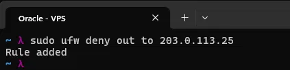

I did not kill anything yet. Killing the process first would destroy the evidence of what it was doing, so the first move was to block the C2 address and then document the running state:

```
sudo ufw deny out to 203.0.113.25
```

This is the step that would cut off the channel to a real C2 server.

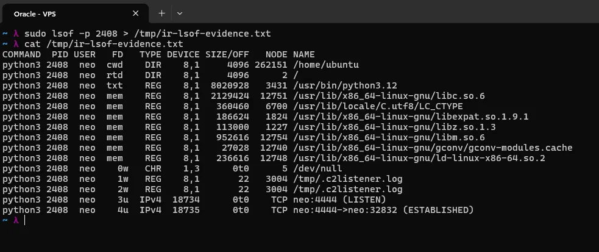

Then I documented the processes before they disappeared:

```
sudo strace -p 2425 -e trace=network &
sudo strace -p 2408 -e trace=network &
sudo lsof -p 2408 > /tmp/ir-lsof-evidence.txt
sudo cat /proc/2408/maps > /tmp/ir-maps-evidence.txt
```

`strace` was attached to both processes in the background to watch their network system calls. I saved the listener's open files to an evidence file, which shows stdout and stderr going to `/tmp/.c2listener.log`, the socket listening on port 4444, and the established connection from port 32832.

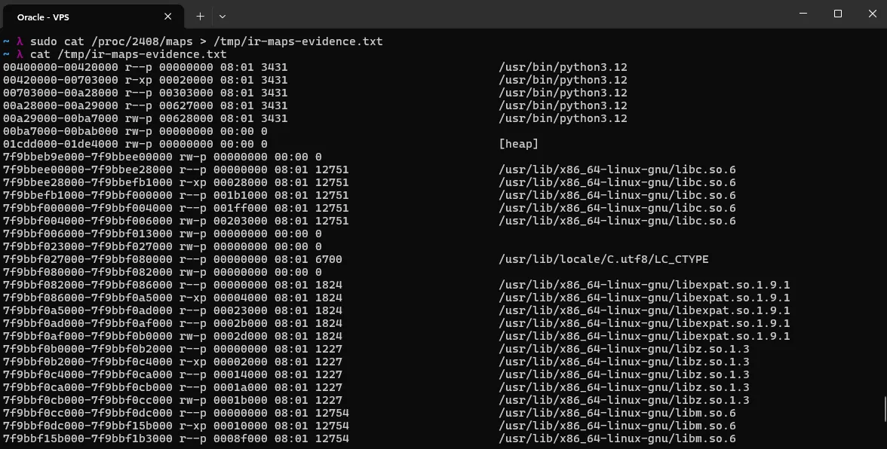

I also saved its memory map. What is visible in the screenshot is the python3.12 binary, the heap, and the usual shared libraries like libc, libexpat, libz and libm, nothing unexpected mapped in.

### Eradication

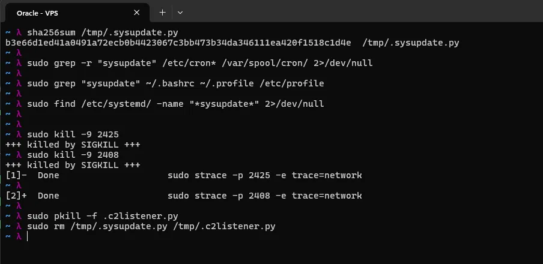

Before removing anything, I hashed the file. In a real case this hash is what gets submitted to VirusTotal to see whether the file is known malware:

```
sha256sum /tmp/.sysupdate.py
```

Then I checked for persistence, anything that would bring it back after a kill or a reboot, in cron, the shell startup files, and systemd:

```
sudo grep -r "sysupdate" /etc/cron* /var/spool/cron/ 2>/dev/null
sudo grep "sysupdate" ~/.bashrc ~/.profile /etc/profile
sudo find /etc/systemd/ -name "*sysupdate*" 2>/dev/null
```

None of them returned anything, so there was no persistence to clean up. With that confirmed, it was safe to kill the processes and delete the scripts:

```
sudo kill -9 2425
sudo kill -9 2408
sudo pkill -f .c2listener.py
sudo rm /tmp/.sysupdate.py /tmp/.c2listener.py
```

The `killed by SIGKILL` lines in the screenshot are the strace sessions reporting their processes dying, and the two `Done` lines confirm both strace jobs ended along with them. `pkill -f` matches on the command line, as a catch all for the listener in case anything was left, and then both scripts were removed.

### Recovery

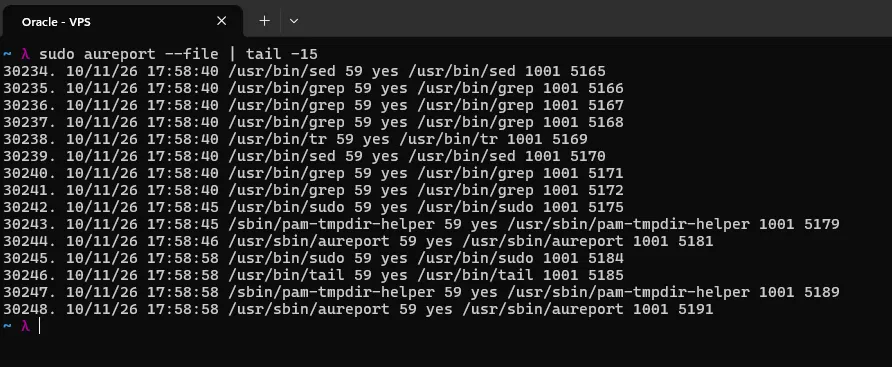

For recovery I first checked for anything else suspicious on the box and reviewed which files had been accessed, using auditd from the hardening sprint:

```
sudo rkhunter --check --sk
sudo aureport --file
```

The tail of the `aureport` output in the screenshot is just the tools I was running myself during the cleanup (sed, grep, tr, sudo, aureport), all under the same audit user ID, nothing unexpected.

Then I cleaned up the lab artefacts and turned the detection into a permanent one:

```
sudo ip addr del 203.0.113.25/32 dev lo
sudo ufw delete deny out to 203.0.113.25
sudo sed -i 's/LAB: //' /var/lib/suricata/rules/local.rules
sudo suricatasc -c ruleset-reload-rules
```

The loopback alias was only there for the lab, so it goes. I removed the firewall rule because the lab is over, but in a real incident that block would stay in place. Removing the `LAB:` prefix from the rule message turns the lab rule into a standing detection for that address, and the rules are reloaded so it takes effect.

## Incident Report

The incident report for this incident is as [c2_incident_report](https://github.com/5ingul4ri7y/homelab/tree/main/Audits_and_Reports/c2_incident_report)

## Post-Mortem

The post-mortem for this incident is at [post_mortem_c2](https://github.com/5ingul4ri7y/homelab/blob/main/Post_Mortems/postmortem_vps_c2_incident.md)

## Risk Assessment

The risk assessment for the VPS is at [risk_assessment](https://github.com/5ingul4ri7y/homelab/blob/main/Audits_and_Reports/risk_assessment_vps).
