# Deep Log Analysis

My VPS has been running for a long time. The journal contains the entire attack history: every brute-force attempt, every scanning bot, every legitimate login. In this lab I extract intelligence from that data and automate a daily report.

---

## Intelligence Extraction

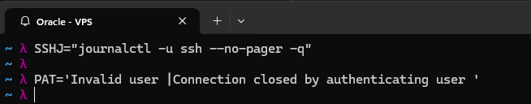

I saved a command I'll use again and again for getting journal entries about ssh into two shell variables: `SSHJ` holds the journalctl command that gets the logs, and `PAT` holds the pattern which shortlists the attack attempts from the logs.

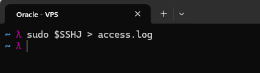

I ran the command and saved the output for intelligence extraction in a file (`access.log`) so I don't have to query the journal multiple times.

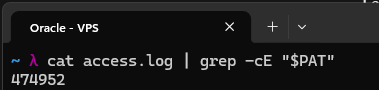

Firstly, I checked how many attacks there have been in total, which came to 474,952. My VPS is about 6 months old and no logs have been lost, so this shows all the attacks during this period.

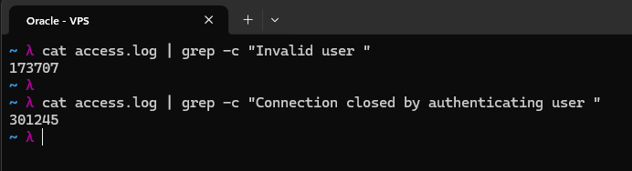

I then compared the attacks by how many used invalid usernames (173,707) vs how many used actual usernames, mostly root (301,245).

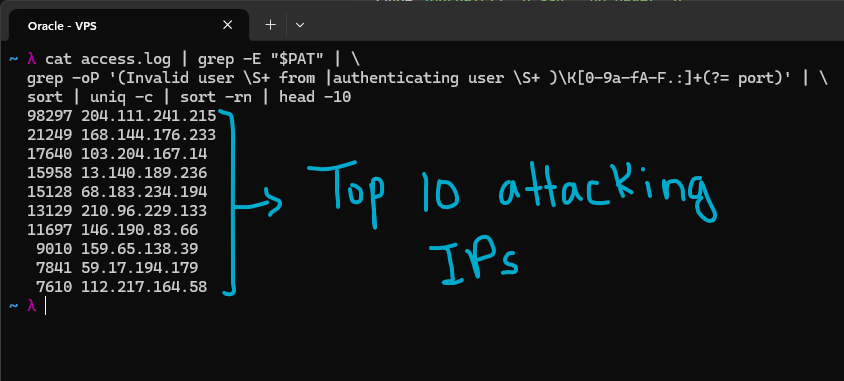

I then listed the top 10 attacking IP addresses, along with the number of attack attempts by each IP. The busiest one alone made 98,297 attempts.

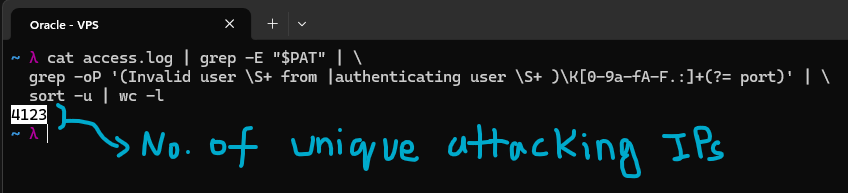

In total, 4,123 unique IP addresses have attempted to access the VPS throughout its time being up.

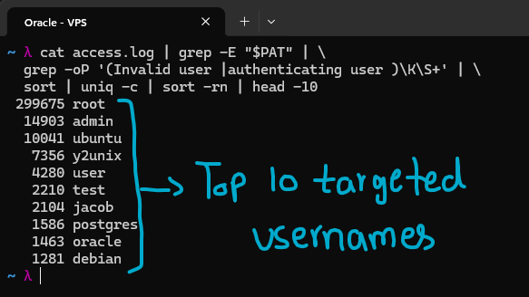

I then extracted the top 10 targeted usernames in brute-force attacks along with the number of times they were used. Of course root was the most used (299,675 times), which fits the result above where attempts with actual usernames, mostly root, outnumbered the ones with invalid usernames. But we have disabled root access through ssh, so these attacks are dead ends.

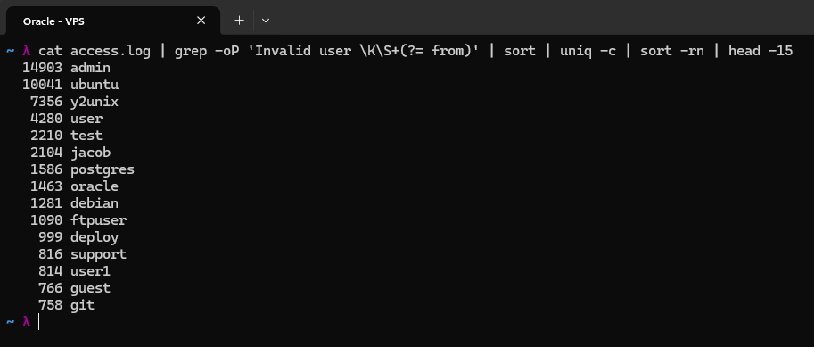

These are the top 15 invalid usernames that were used during attack attempts, meaning names that do not exist on my server, which is why root is not in this list. It was done as a vulnerability probe, so I don't end up using a username that is being tried as part of the attack attempts. I realized I was in the clear after looking at the result.

---

## Automating daily report

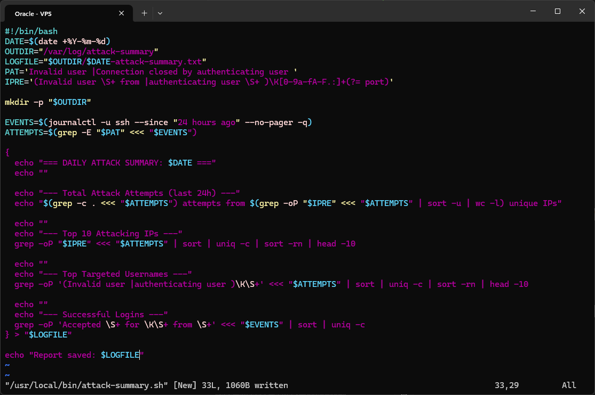

I wrote a script using the command patterns established above, with the intention of automating a run of it daily and saving a formatted report to a log file. The script lives at `/usr/local/bin/attack-summary.sh`. Instead of reading `access.log`, it pulls the last 24 hours straight from the journal with `--since "24 hours ago"`, and it adds a successful logins section at the end using the `Accepted` lines. Each report is saved as a dated file in `/var/log/attack-summary/`.

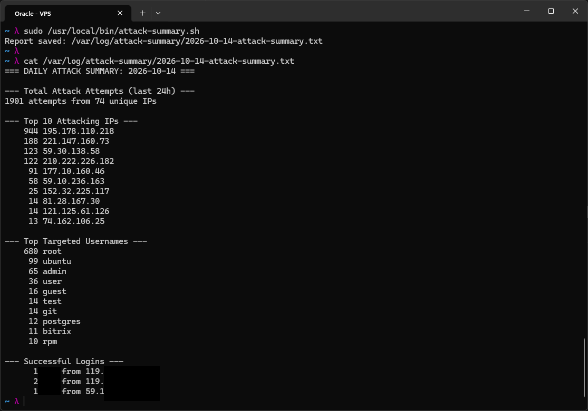

As can be seen here, the script produced a professionally formatted report of the last 24 hours of attack attempts (1,901 attempts from 74 unique IPs), with the top 10 attacking IPs and top targeted usernames, along with my own successful logins and the IP addresses they came from, so I can catch any that I don't recognize. The usernames and IPs in the successful logins section are blacked out here.

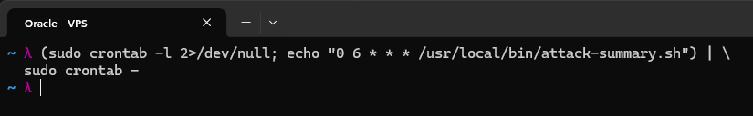

I then put this in root's crontab so it runs daily at 6:00 AM (server time) and writes to the log file with the dated name. This way, I have a report of each day.

---
