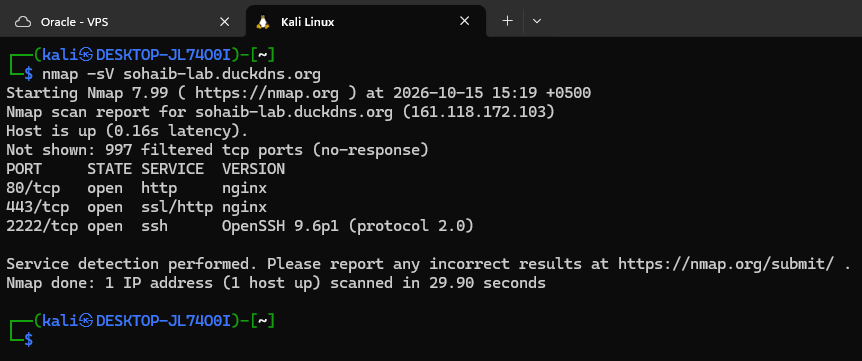
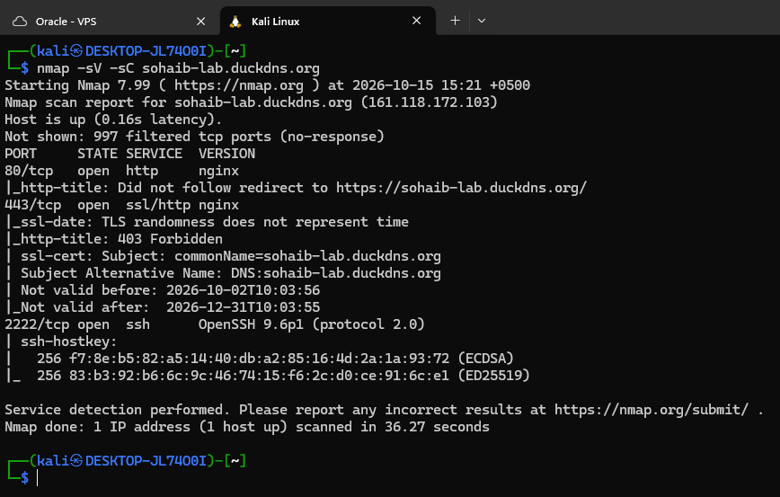
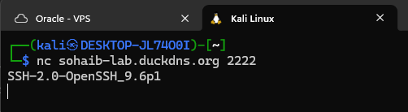
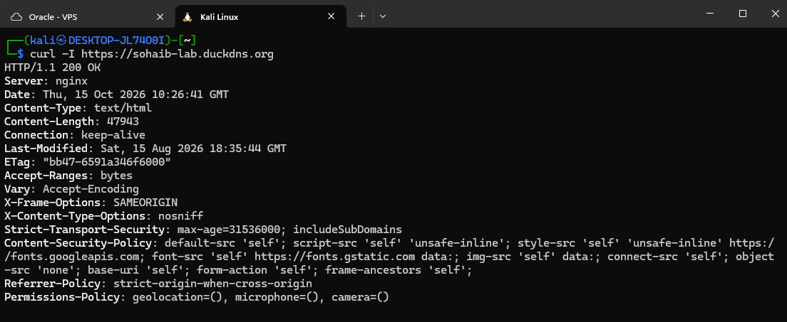
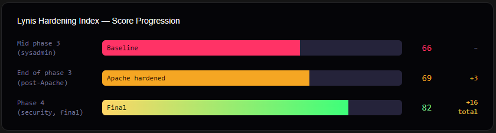

# Security Audit

Today I see my VPS through an attacker's eyes: running nmap from Kali against my own server.

---

## Attacker's Perspective: nmap from Kali

Basic service scan (`nmap -sV`):
- Port 2222/tcp open (non-standard ssh port)
- Port 80/tcp (web)
- Port 443/tcp (web)
- The other 997 ports are filtered (no response)

An advanced scan (`nmap -sV -sC`) shows that the OpenSSH version number (9.6p1) is visible but no distro details are leaking, and the nginx version is not leaked either. The SSL cert is for my domain and is within its validity period (2026-10-02 to 2026-12-31). HTTP port (80) redirects to HTTPS (nmap reports that it did not follow the redirect to https://sohaib-lab.duckdns.org/).

On port 443, nmap's `http-title` reported 403 Forbidden even though `curl -I` returned 200 OK. To test why, I ran curl again with nmap's user agent string and got 403 Forbidden as well. This confirmed that the ModSecurity WAF on nginx detects the nmap probing and blocks it.

I also grabbed the SSH banner manually with netcat (`nc sohaib-lab.duckdns.org 2222`). It shows the OpenSSH version (9.6p1) but does not reveal any build details or the OS version.

Inspecting the HTTP response headers (`curl -I https://sohaib-lab.duckdns.org`) reveals:
- No Nginx version is leaked (just `Server: nginx`)
- X-Frame-Options is set (SAMEORIGIN)
- Strict-Transport-Security is present
- Other security headers are present as required by my homelab site: Content-Security-Policy, X-Content-Type-Options, Referrer-Policy and Permissions-Policy

---

## Lynis Score Progression

I ran Lynis one final time and compared all three scores. My scores went from 66 at the baseline (mid phase 3), to 69 at the end of phase 3, to 82 in the final run (phase 4), a total gain of 16. This chart shows the hardening journey:

**What the score means:** Lynis scores range from 0 to 100. Roughly, 65 is average for a freshly installed Ubuntu server, 70 to 80 means common hardening has been applied, 80 to 90 is serious hardening effort, and above 90 needs deep kernel hardening and often breaks usability. My target for this VPS was 80+, and my final score of 82 meets it.

---

## SIEM (Security Information and Event Management)

A SIEM collects the logs from every system in an organization into one central platform, correlates events across the different sources, and raises alerts when patterns match known attack signatures. Every tool I have worked with in this lab series already produces its own logs, so a SIEM would not replace any of them, it would just bring them all into one place.

### What would feed into it

- **Suricata:** network IDS alerts and flow data
- **auth.log / SSH:** login attempts and sudo events
- **Nginx logs:** HTTP requests, errors and WAF alerts
- **UFW / iptables:** firewall allow and deny decisions
- **auditd:** file access, program execution and privilege events
- **fail2ban:** IP bans and jail activity
- **Windows Event Log:** AD logins and GPO changes, for example event IDs 4624 and 4625 (successful and failed logons)
- **Netdata / vnstat:** performance and bandwidth anomalies

All of these get shipped to the central SIEM with something like rsyslog, Elastic Agent or Filebeat.

### What the SIEM does with them

Common options are the Elastic Stack (ELK), Splunk, Graylog and Microsoft Sentinel. Once the logs are in, it:

- correlates events across all the sources
- detects patterns over time
- generates prioritized alerts
- stores an immutable log archive

### What comes out of it

- real-time alerts to SOC analysts
- dashboards and trend reports
- a forensic log archive (90+ days)

I have not built a SIEM in this lab. This section is the concept and how the pieces I already used would connect to it.

---
