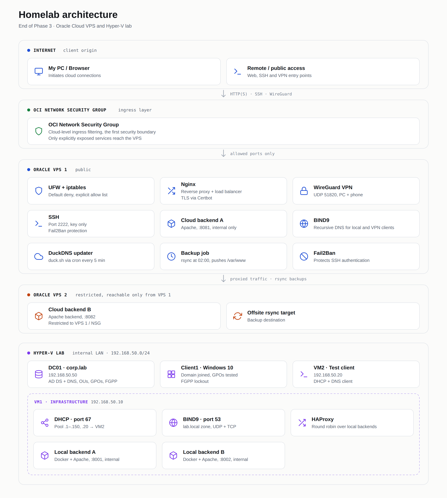

# Phase 3 - Sysadmin Infrastructure: Services, Directory and Hardening

## What I Built

A public-facing web stack on Oracle Cloud (Nginx reverse proxy with Let's Encrypt TLS in front of two Dockerized Apache backends, one on a second VPS locked to the first VPS's IP) with hardened SSH, layered OCI and host firewalls, BIND9 and WireGuard-aware DNS, and offsite rsync backups. Alongside it, a Hyper-V network ("Internal-LAN") with a Windows Server 2022 Active Directory domain (`corp.lab`) and a domain-joined Windows 10 client, plus Ubuntu VMs running DNS, DHCP, HAProxy, Samba, NFS and FTP labs. The phase ended with a port-by-port audit of the VPS and a Lynis re-measurement.

## Key Accomplishments

**Web and proxy**
- [x] Built Apache2 with a named virtual host on `sohaib-lab.duckdns.org`, then hardened it: `ServerTokens Prod`, `ServerSignature Off`, six security headers, unused modules disabled (A+ on securityheaders.com for the Apache site)
- [x] Issued and auto-renewed Let's Encrypt certificates and verified the chain (`certbot --apache`, `certbot renew --dry-run`, `openssl s_client -showcerts`)
- [x] Put Nginx in front as a round-robin reverse proxy across two Docker backends, one on a separate VPS reachable only from VPS 1 (OCI NSG rule plus host firewall)
- [x] Built HAProxy on a Hyper-V VM with HTTP health checks, a stats page on port 8404, automatic failover (`docker stop backend_b`) and manual enable/disable through the stats socket

**SSH and firewalling**
- [x] Hardened SSH: key-only auth, no root login, `MaxAuthTries 3`, `LoginGraceTime 30`, non-default port, with a second session kept open during changes
- [x] Added fail2ban with a custom SSH jail (3 retries in 600 seconds)
- [x] Learned iptables from the ground up on an isolated VM (rule order, default-DROP policy, `multiport`) and wrote a default-deny firewall script
- [x] Moved the VPS to UFW with default deny, WireGuard routed rules and NAT masquerading in `/etc/ufw/before.rules`
- [x] Audited every listener and running service on the VPS, justifying each against `ss`, UFW, the OCI NSG and service config

**DNS and DHCP**
- [x] Built BIND9 as a forwarding, caching resolver with `allow-recursion` restricted to a trusted ACL (query time 481 ms cold, 0 ms from cache)
- [x] Wrote an authoritative zone for `lab.internal` (SOA, NS, A, CNAME), validated with `named-checkzone`, and tested NXDOMAIN
- [x] Added a reverse zone with PTR records (`dig -x`) and an internal `lab.local` zone serving a second VM with a search domain
- [x] Replaced BIND9 with dnsmasq (DNS plus DHCP), then with isc-dhcp-server plus BIND9, and watched the full DORA exchange in the logs
- [x] Documented BIND9 vs dnsmasq and inspected SPF, DKIM and DMARC records on real domains (`dig _dmarc.google.com TXT`)

**Active Directory**
- [x] Queried LDAP directly with `ldapsearch` before building anything in Windows
- [x] Promoted Windows Server 2022 to a domain controller (`DC01`, forest `corp.lab`), joined a Windows 10 client, and created OUs, users and a security group in PowerShell
- [x] Enforced a wallpaper GPO on the IT OU and verified it with `gpresult /r`
- [x] Created a Fine-Grained Password Policy (16-character minimum, 3-attempt lockout, 30-minute duration) and proved it by locking out a user from the client

**File services, backup and operations**
- [x] Served Samba shares (public guest and private authenticated) and NFS exports with per-IP `rw`/`ro` rules, tested from two clients
- [x] Captured FTP credentials in plaintext with `tcpdump`, then used SFTP over the existing SSH setup
- [x] Automated weekday 2 AM offsite backups with rsync, a logging script and cron, and tested a restore
- [x] Verified time sync with chrony (`chronyc tracking`, `makestep`)
- [x] Partitioned a new 10GB disk with `parted` (GPT, ext4, XFS, swap) and mounted it persistently by UUID in `/etc/fstab`

**Measured outcomes**
- [x] Disabled six unneeded services (rpcbind, rpc-statd, squid, fwupd, ModemManager, udisks2); running services went from 29 to 23 and all six related listening ports disappeared
- [x] Lynis hardening index improved from 66 to 69 (see [lynis_mid_phase3](../Audits_and_Reports/lynis_mid_phase3/README.md) and [lynis_end_phase3](../Audits_and_Reports/lynis_end_phase3/README.md))

## Technologies Used

| Tool | Purpose | Evidence |
|---|---|---|
| Apache2 | Web server, virtual hosts, header hardening | [apache2/](apache2/README.md), [apache2_virtualhost/](apache2_virtualhost/README.md), [apache_hardening/](apache_hardening/README.md) |
| Nginx, Docker | Reverse proxy and load balancing across containers | [nginx_load_balancing/](nginx_load_balancing/README.md) |
| HAProxy | Health checks, failover, stats | [haproxy_load_balancing/](haproxy_load_balancing/README.md) |
| Certbot, DuckDNS | TLS certificates and dynamic DNS | [dns_tls/](dns_tls/README.md) |
| OpenSSH, fail2ban | SSH hardening and brute-force banning | [ssh_hardening/](ssh_hardening/README.md) |
| iptables, UFW | Packet filtering and WireGuard routing | [iptables/](iptables/README.md), [ufw_firewall/](ufw_firewall/README.md) |
| ss, systemctl, Lynis | Listener audit and hardening score | [port_audit_phase3/](port_audit_phase3/README.md) |
| BIND9 | Recursive, authoritative and reverse DNS | [DNS_Labs/](DNS_Labs/bind9_caching_resolver/README.md) |
| dnsmasq, isc-dhcp-server | DHCP and DNS for the internal network | [dnsmasq_dns_dhcp/](DNS_Labs/dnsmasq_dns_dhcp/README.md), [isc-dhcp-server/](isc-dhcp-server/README.md) |
| Windows Server 2022, AD DS, Group Policy | Directory services and policy | [active_directory_ou_gpo/](active_directory_ou_gpo/README.md), [active_directory_fgpp/](active_directory_fgpp/README.md) |
| LDAP (ldapsearch) | Directory protocol fundamentals | [active_directory_ldap/](active_directory_ldap/README.md) |
| Samba, NFS, vsftpd, SFTP | File sharing and transfer | [samba_file_sharing/](samba_file_sharing/README.md), [nfs_protocol/](nfs_protocol/README.md), [file_transfer_protocols/](file_transfer_protocols/README.md) |
| rsync, cron | Scheduled offsite backup | [rsync-backup-automation/](rsync-backup-automation/README.md) |
| chrony | NTP time synchronization | [ntp_protocol/](ntp_protocol/README.md) |
| parted, mkfs, fstab | Disk partitioning and persistent mounts | [linux_disk_partitioning/](linux_disk_partitioning/README.md) |

## Key Learnings

Configuration is not verification. A port I assumed was protected (Docker's 8081 behind Nginx) was only proven safe once I confirmed that neither the OCI NSG nor UFW allowed it. BIND9 was only safe because of its `allow-recursion` ACL, not because of which interface it listened on. The FGPP only counted once I saw the lockout happen from a real client, and the backup only counted once a restore worked.

Services that look similar divide the work differently. dnsmasq does DNS and DHCP in one file, while isc-dhcp-server needs BIND9 beside it, and BIND9 itself splits options, zones and zone files across separate files. Samba keeps its own password database and NFS trusts client IPs. Choosing between them, and between Apache, Nginx and HAProxy, depends on the job, not on which one is "better".

## Files in This Directory

| Folder | Description |
|---|---|
| [apache2/](apache2/README.md) | Install, OCI and iptables ports, custom default page |
| [apache2_virtualhost/](apache2_virtualhost/README.md) | Config layout, virtual host, DuckDNS domain |
| [apache_hardening/](apache_hardening/README.md) | ServerTokens, security headers, module cleanup, Lynis baseline |
| [dns_tls/](dns_tls/README.md) | DuckDNS update script, Let's Encrypt, TLS handshake notes |
| [nginx_load_balancing/](nginx_load_balancing/README.md) | Nginx reverse proxy across two Dockerized backends |
| [haproxy_load_balancing/](haproxy_load_balancing/README.md) | HAProxy health checks, failover, stats socket |
| [ssh_hardening/](ssh_hardening/README.md) | sshd settings and fail2ban |
| [ufw_firewall/](ufw_firewall/README.md) | UFW rules, WireGuard routing and NAT |
| [iptables/](iptables/README.md) | netfilter theory, interactive rules, firewall script |
| [port_audit_phase3/](port_audit_phase3/README.md) | Listener audit, service cleanup, end-of-phase Lynis |
| [DNS_Labs/bind9_caching_resolver/](DNS_Labs/bind9_caching_resolver/README.md) | Recursive caching resolver with trusted ACL |
| [DNS_Labs/bind9_dns_server/](DNS_Labs/bind9_dns_server/README.md) | Authoritative zone, SOA, trailing dot behavior |
| [DNS_Labs/bind9_reverse_dns/](DNS_Labs/bind9_reverse_dns/README.md) | Reverse zone and PTR records |
| [DNS_Labs/bind9_internal_dns/](DNS_Labs/bind9_internal_dns/README.md) | Serving DNS to a second VM, search domain |
| [DNS_Labs/dnsmasq_dns_dhcp/](DNS_Labs/dnsmasq_dns_dhcp/README.md) | dnsmasq DNS plus DHCP |
| [DNS_Labs/bind9_vs_dnsmasq/](DNS_Labs/bind9_vs_dnsmasq/README.md) | Comparison of the two |
| [DNS_Labs/dns_for_web_servers/](DNS_Labs/dns_for_web_servers/README.md) | A, AAAA, SOA, TXT records and the TLS layer |
| [DNS_Labs/dns_email_security/](DNS_Labs/dns_email_security/README.md) | SPF, DKIM and DMARC |
| [isc-dhcp-server/](isc-dhcp-server/README.md) | ISC DHCP with reservation, DORA in the logs |
| [active_directory_ldap/](active_directory_ldap/README.md) | LDAP concepts and the domain controller build |
| [active_directory_ou_gpo/](active_directory_ou_gpo/README.md) | OUs, users, domain join, GPOs and inheritance |
| [active_directory_fgpp/](active_directory_fgpp/README.md) | Fine-Grained Password Policy and lockout test |
| [samba_file_sharing/](samba_file_sharing/README.md) | Samba public and private shares |
| [nfs_protocol/](nfs_protocol/README.md) | NFS exports and per-client access |
| [samba_vs_nfs/](samba_vs_nfs/README.md) | Comparison of the two |
| [file_transfer_protocols/](file_transfer_protocols/README.md) | FTP, SFTP and TFTP |
| [rsync-backup-automation/](rsync-backup-automation/README.md) | rsync, cron, restore test, 3-2-1 rule |
| [ntp_protocol/](ntp_protocol/README.md) | Stratum hierarchy and chrony |
| [linux_disk_partitioning/](linux_disk_partitioning/README.md) | GPT, parted, filesystems, fstab by UUID |
